# Alpha3

OpenMW for Android and iOS, with a launcher that sets up Morrowind, downloads whole mod lists and fixes them up for you.

<p align="center">
  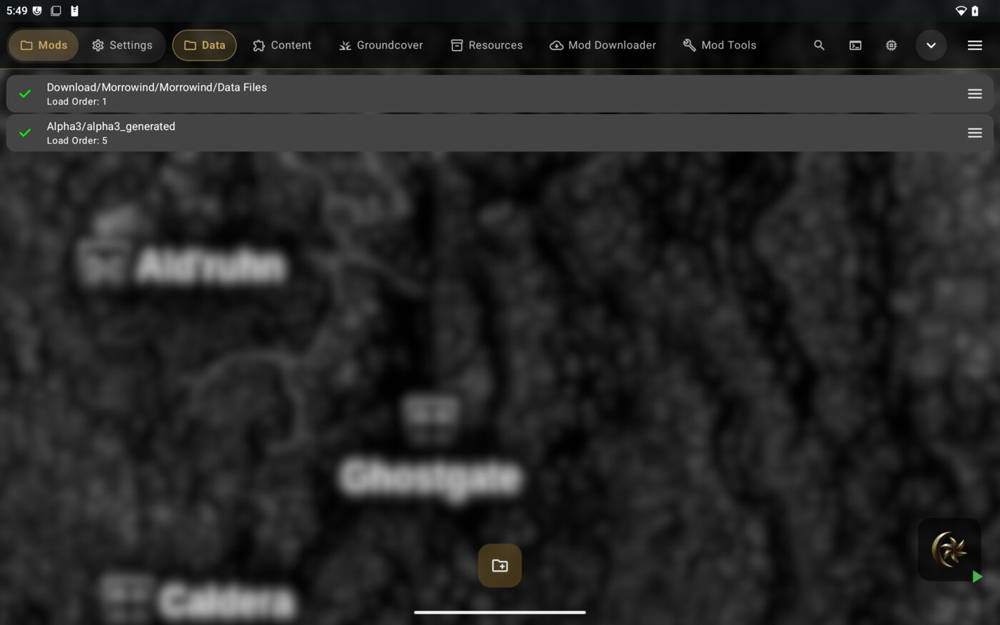
  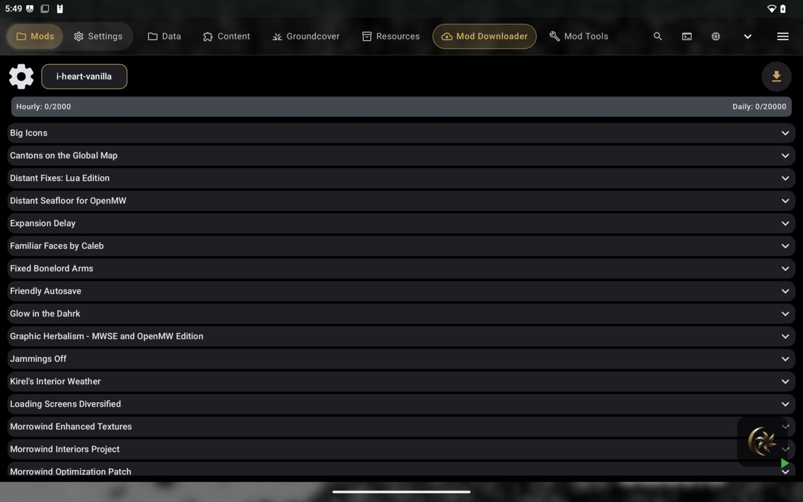
</p>

## Contents

- [Quick start](#quick-start)
- [A tour of the launcher](#a-tour-of-the-launcher)
- [Downloading a mod list](#downloading-a-mod-list-mod-downloader)
  - [Free Nexus accounts](#free-nexus-accounts-slow-downloads)
- [Mod Tools](#mod-tools)
- [Free up space: remove overridden files](#free-up-space-remove-overridden-files-experimental)
- [Settings, GPU driver and controls](#settings-gpu-driver-and-controls)
- [Help and search inside the app](#help-and-search-inside-the-app)
- [Troubleshooting](#troubleshooting)
- [Building from source](#building) (for developers)

## Quick start

1. Get your own copy of Morrowind (Steam, GOG or disc) and put its `Data Files` folder on the device.
2. Open the launcher. On the **Data** tab, press the folder button at the bottom and add the Morrowind `Data Files` folder. It becomes load order 1.
3. On the **Content** tab, tick `Morrowind.esm` (and `Tribunal.esm` / `Bloodmoon.esm` if you have them).
4. Press the **Play** button at the bottom right.

## A tour of the launcher

The bar at the top has two groups, switched with the **Mods | Settings** toggle on the left. The selected tab is outlined in gold. The icons on the right are Search, Help, and (with developer options on) Terminal and Kram.

On tablets and in landscape the Play button floats at the bottom right. In portrait on a phone, the usual bottom navigation is used instead.

| | |
|---|---|
|  | 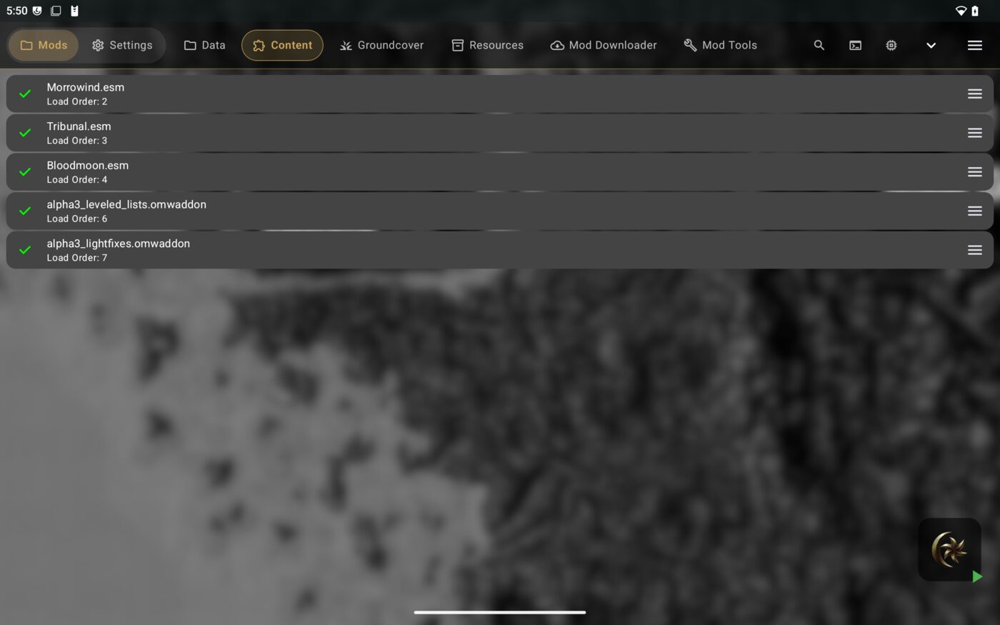 |
| **Data**: the folders OpenMW loads files from. Later rows win when two mods have the same file. Drag the handle on the right to reorder; the Load Order number shows each row's position. | **Content**: the plugins (`.esm`, `.esp`, `.omwaddon`) found in those folders. Tick the ones you want. Masters go first. |
| 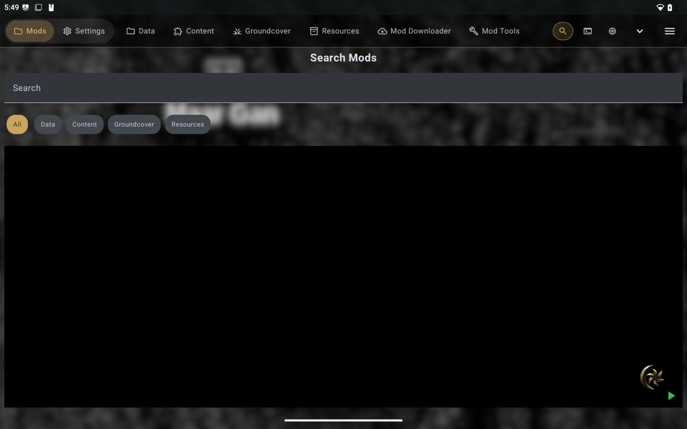 | 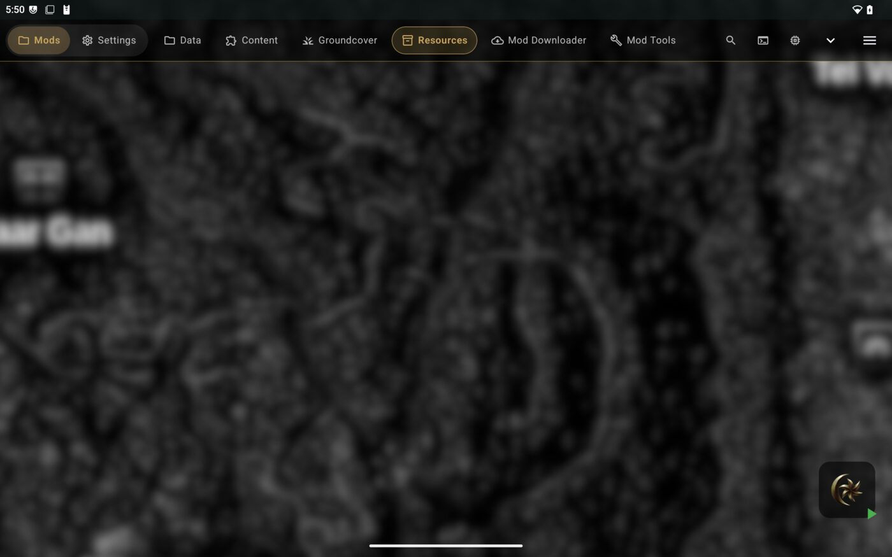 |
| **Groundcover**: plugins whose grass and plants OpenMW draws as groundcover. | **Resources**: archives (BSA) and other resource entries the game loads. |

The same screens in portrait:

<p align="center">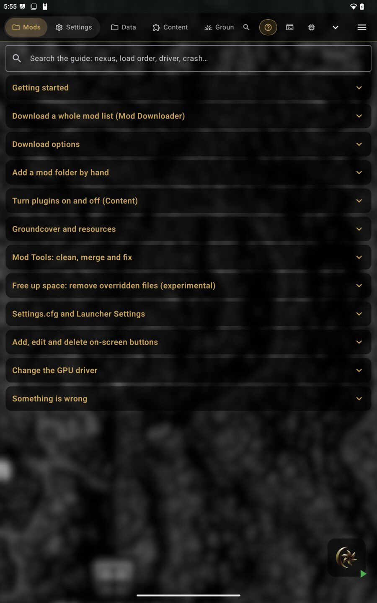</p>

**Search** (the magnifying glass) looks through the mods in your lists. Use the chips under the box (All, Data, Content, Groundcover, Resources) to narrow it down.

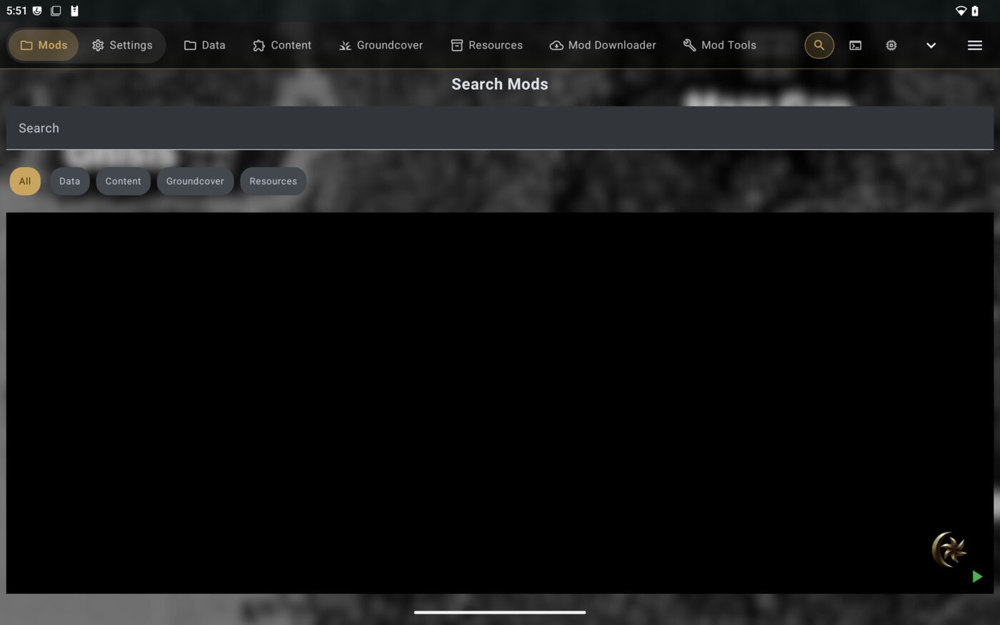

## Downloading a mod list (Mod Downloader)

The Mod Downloader fetches a whole list of mods from [modding-openmw.com](https://modding-openmw.com) (the same lists as the UMO tool), downloads each archive, unpacks it, runs the list's file actions, and writes a ready-to-use `openmw.cfg`.

**You need:** a [Nexus Mods](https://www.nexusmods.com) account and its API key, plenty of free space, and a network connection. Premium accounts download automatically. Free accounts confirm each file on the Nexus website; see [Free Nexus accounts](#free-nexus-accounts-slow-downloads) below. Nexus limits how many requests you can make per hour and per day; the limits are shown above the list.

1. Open **Mods > Mod Downloader**. The first time, it fetches the lists, which can take a moment.
2. Tap the list name at the top-left and pick a list. The number is how many mods it has.

   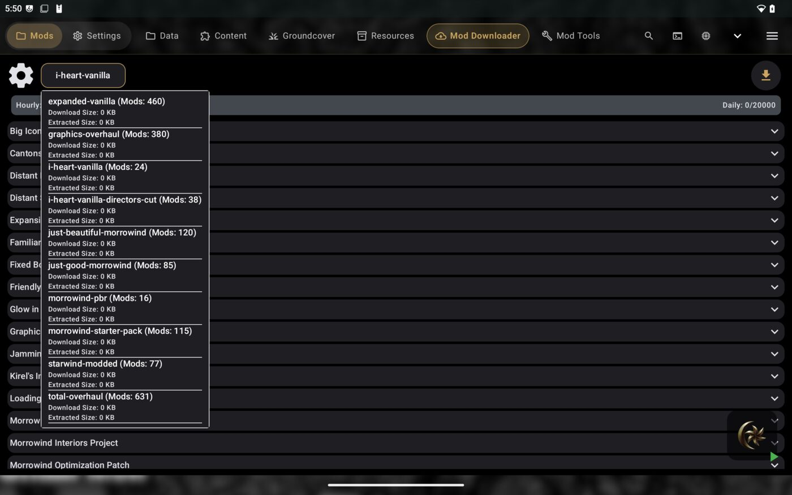

3. Tap the **gear** to open **Download Options**:

   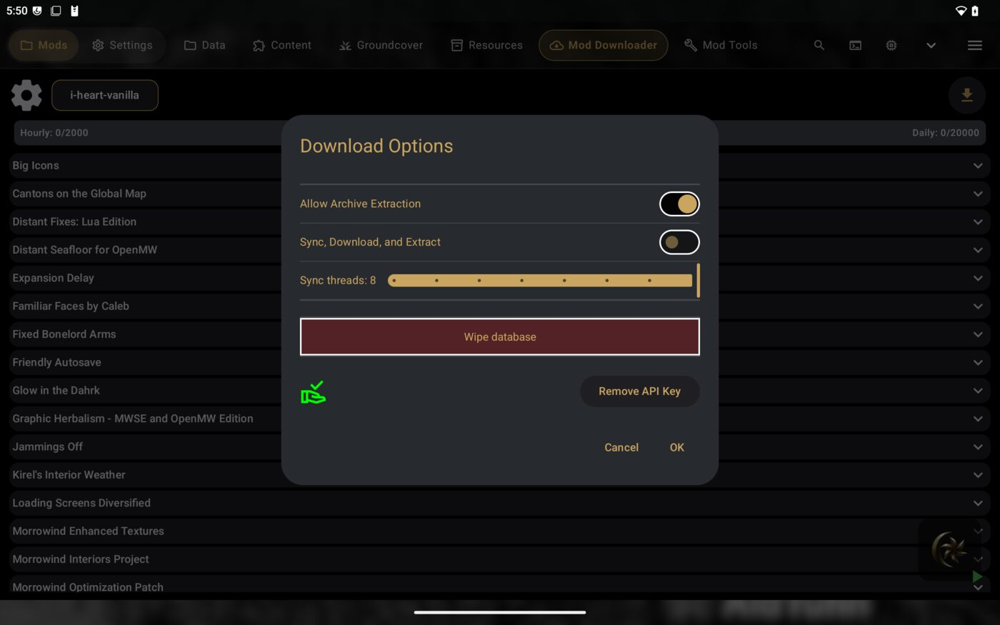

   - **Allow Archive Extraction**: leave on to unpack what is downloaded. Turn off to download only.
   - **Sync, Download, and Extract** / **Only do the sync process**: the second only refreshes the list data and downloads nothing.
   - **Sync threads**: how many mods are looked up at the same time during the sync step. Lower it if requests fail or Nexus limits you.
   - **Wipe database**: clears the mod entries the app has stored so the lists are synced again. It does not touch files already on disk.
   - **Nexus API key**: paste your key and save it. **Remove API Key** signs it out.

4. Tap the **download button** at the top right to start. Each mod shows its progress, speed and extraction state. You can leave the screen and come back.
5. When the whole list is downloaded and unpacked, the list is installed into a **profile** of its own, `Alpha3/config/<list>` (for example `Alpha3/config/i-heart-vanilla`), and an **"<list> installed"** box tells you what was done:
   - **settings.cfg** is copied from your default profile (`Alpha3/config`), so your graphics and control settings carry over. If the profile already has its own `settings.cfg` (you installed the list before), it is kept.
   - **openmw.cfg** is *replaced* by the list's generated `Alpha3/OpenMW/<list>.cfg`. It is not appended: the generated file already holds the game's data folder, the fallback values, the archives, every mod folder and every plugin (Morrowind and the expansions too), so adding it to the default's lines would only list them twice.
   - Every `data=`, `content=`, `groundcover=` and `fallback-archive=` line is checked. If the file or folder is missing, the line is disabled with a `;` in front, and a backup is saved as `openmw.cfg.alpha3-check.bak`. The box says how many were disabled. Nothing is re-enabled automatically, so download the missing mod again and remove the `;` yourself.
   - Saves, screenshots and the navmesh of that list are kept in the profile folder too.
   - **Switch to <list>** makes the profile active; **Stay on current** leaves your active profile alone. **Review Logs** shows what happened, including any mods that failed.
6. **Profiles.** The menu at the top right has **Profile: <name>**. It opens the switcher: tap a profile to use it, create one by name (it starts as a copy of the default `openmw.cfg` and `settings.cfg`), or delete one. The **Default** profile is the plain `Alpha3/config` folder and stays in use until you switch. Everything that reads or writes `openmw.cfg` and `settings.cfg` (the Data, Content and Groundcover lists, the settings pages, Mod Tools, the navmesh, the log and crash views and the game itself) uses the active profile.
7. Open **Mod Tools** (below), then press **Play**.

### Free Nexus accounts (slow downloads)

Free accounts cannot download through the API, so Nexus needs a button press for every file. The launcher keeps that to one tap per file:

**You need:** to be signed in to Nexus Mods in your phone's browser (the launcher opens the pages in a browser tab, so it uses your existing sign-in), and your Nexus API key saved in **Download Options**. The API key and the browser must be the **same Nexus account**.

1. Tap the **download button** next to the list name, or **Download** on a single mod. For every file that is not already downloaded, the launcher opens that file's Nexus page in a browser tab. Only one tab is open at a time; the others wait in a queue. The biggest files are queued first so they are not left to the end.

   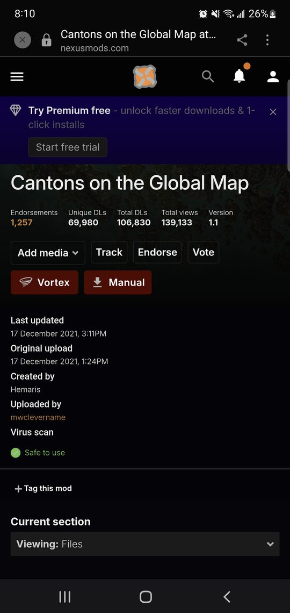

2. Scroll down to the **Free: Slow download** box and press **Slow download**. The button is greyed out for a few seconds, then it turns on. **Do not press the blue "Fast download - free trial" button.**

   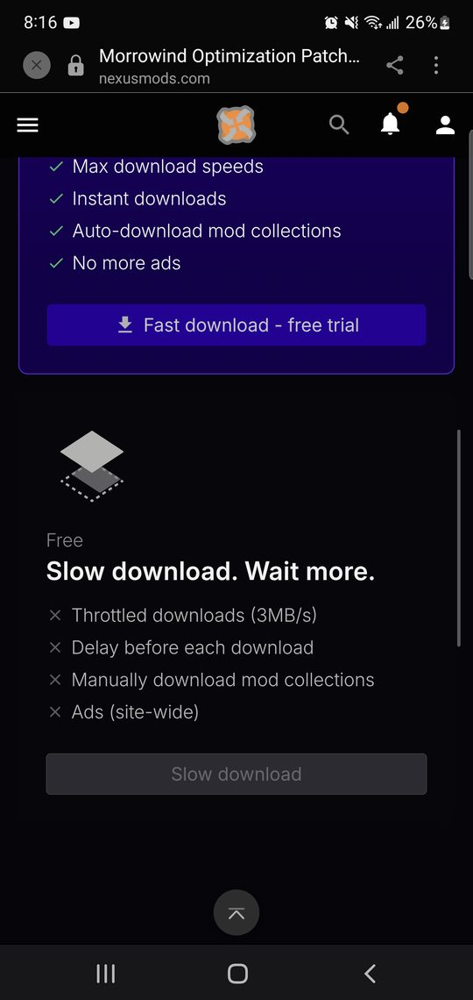

3. The browser hands the file back to the launcher, which comes to the front and starts the download itself. The next file's page opens straight away, so repeat step 2 for each one. You do not have to wait for a download to finish before pressing the next button.
4. Files are saved in `Alpha3/OpenMW/CACHE` and unpacked into `Alpha3/OpenMW/Mods/<category>/<mod folder>`. The top of the list shows how many files are left, how many are downloading, how many are extracting and how many are waiting for the browser. Large files can take several minutes on a free account because Nexus limits their speed.

   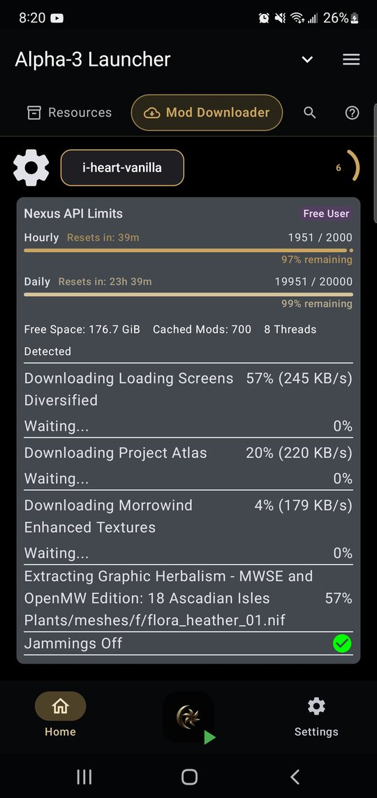

   While a file is downloading, its card shows the percentage, speed and a progress bar, with a **Pause** button (it becomes **Resume**). Press **Skip this file** at the top of the list if a Nexus tab was closed and you want to move on.

   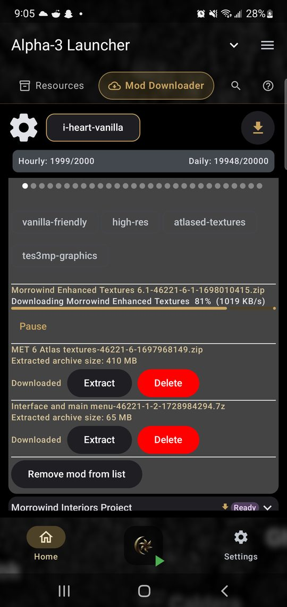

5. When every file is downloaded and unpacked, **Processing Complete** appears (see above). A single mod you downloaded from its card shows **Downloaded** with **Extract** and **Delete** buttons.

   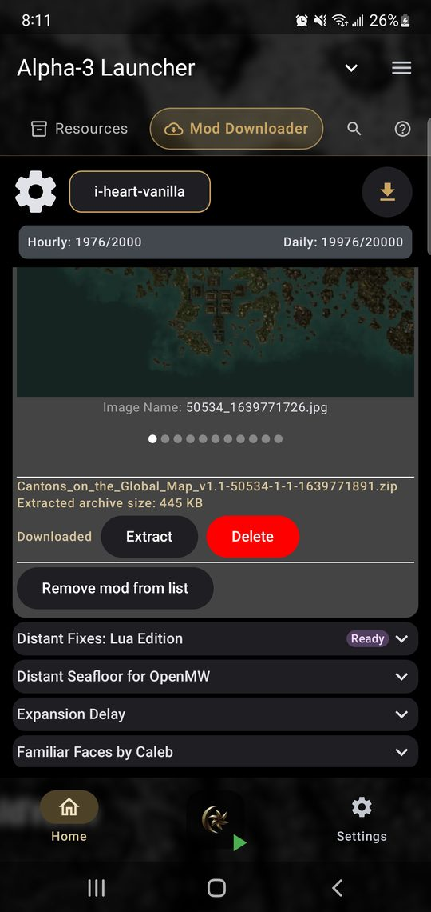

**Stopping and continuing.** A file is saved as `<name>.part` in `Alpha3/OpenMW/CACHE` and renamed only when it is complete, so a half-downloaded file is never unpacked. If the connection drops the launcher retries up to four times, continuing where it stopped. If you close the app or pause for a long time, press **Download** on the file again: the card says "Partial download (N MB)" and the download continues from that point after you press **Slow download** once more.

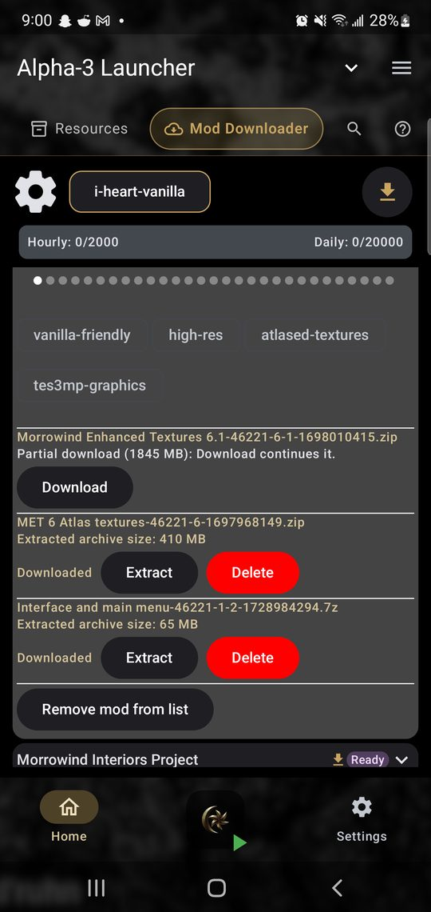

If something goes wrong:
- A message saying the browser is signed in as one Nexus user and the API key belongs to another means the two accounts differ. Use the key from the account the browser is signed in to.
- "Nexus refused the download" or "the link may have expired": the one-time key is only valid for a short time. Press **Slow download** again.
- If you close a Nexus tab without pressing **Slow download**, the queue waits for that file. Press **Skip this file** to move on, and download it again later.

Lists also carry the file *actions* that UMO runs after extracting a mod (remove, rename, copy, copy-rename and clean). The launcher runs the same actions after each archive is unpacked, so the result matches a UMO install.

## Mod Tools

Open **Mods > Mod Tools**. Tick the tools you want and press **Run selected**, or press **Run** next to a single tool. The log underneath shows what each tool did. When a run ends, the config is checked and lines with missing files are disabled, as above.

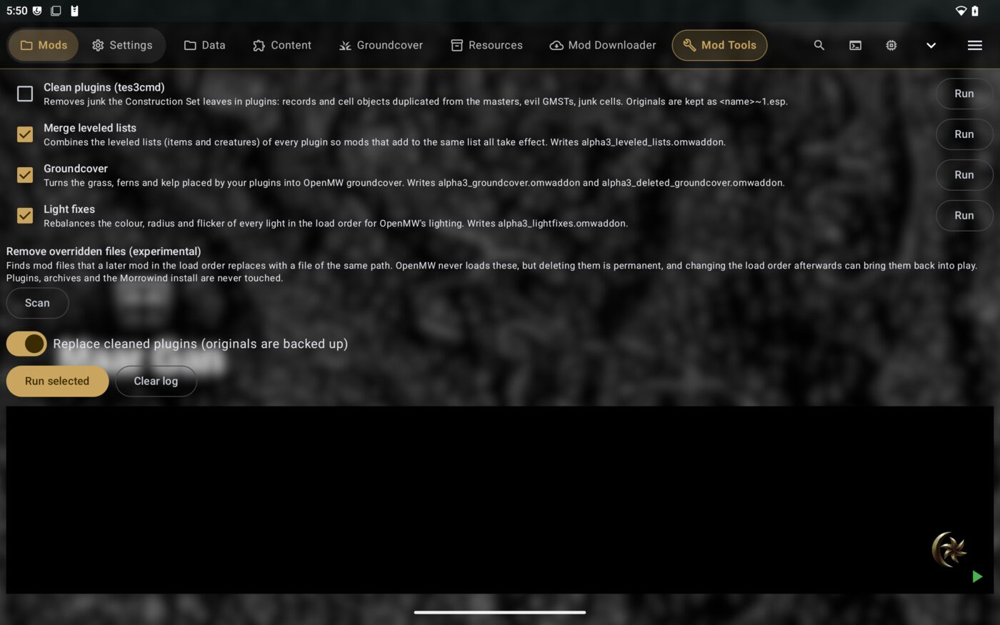

| Tool | What it does | Writes |
|---|---|---|
| Clean plugins (tes3cmd) | Removes junk the Construction Set leaves in plugins | A cleaned copy; the original is backed up when **Replace cleaned plugins** is on |
| Merge records | Combines leveled lists, NPC/creature inventories, spells, AI, dialogue and similar records so mods that change the same record all work | `alpha3_merged.omwaddon` |
| Groundcover | Turns grass, ferns and kelp from your plugins into OpenMW groundcover | `alpha3_groundcover.omwaddon`, `alpha3_deleted_groundcover.omwaddon` |
| Light fixes | Rebalances every light for OpenMW's lighting | `alpha3_lightfixes.omwaddon`, `alpha3_lightfixes.log` |

The generated plugins go in the `alpha3_generated` folder, which the launcher adds to your data folders. Run the tools again whenever you change your load order or add mods.

## Free up space: remove overridden files (experimental)

Big mod lists often contain many files that a later mod replaces. OpenMW only ever loads the last one, so the others are dead weight.

1. Turn on **Settings > Launcher Settings > System & Debug > Enable Developer Options**. The section is hidden until you do.
2. Open **Mod Tools** and press **Scan**. This only counts files; nothing is deleted.
3. Check the numbers. If you want them gone, press **Delete N files** and confirm.

Things to know before you delete:

- Deleting is permanent. The only way back is to download the mod again.
- If you change the load order afterwards, a file you deleted might have been the one you wanted.
- Only files inside the launcher's `OpenMW/Mods` folder are touched. Plugins, archives and your Morrowind install are never touched.
- The launcher keeps a list of what it deleted (`alpha3_pruned.txt`), so unpacked mods are not downloaded and extracted again just because files are missing.
- Updating or re-extracting a mod can bring its files back. Scan again afterwards.

On a test list with 2,082 overlapping files, the scan found 1,138 overridden files (273 MiB) that were safe to remove.

## Settings, GPU driver and controls

The **Settings** group has Launcher Settings, Settings.cfg, Controls and (with developer options on) a Developer Menu.

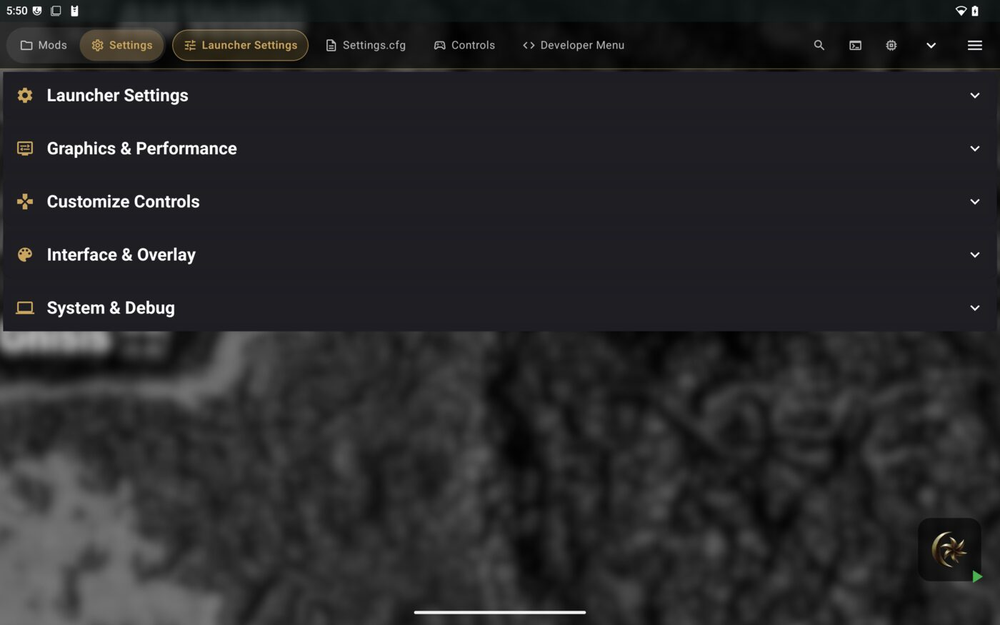

**Change the GPU driver.** Open **Settings > Launcher Settings > Graphics & Performance**. Turn on **Use Freedreno driver** to use an open-source Turnip driver instead of the device's own. Pick the bundled driver, or download another from the list or from a link to a driver `.zip`. Only install drivers you trust. Close and restart the game for the change to apply.

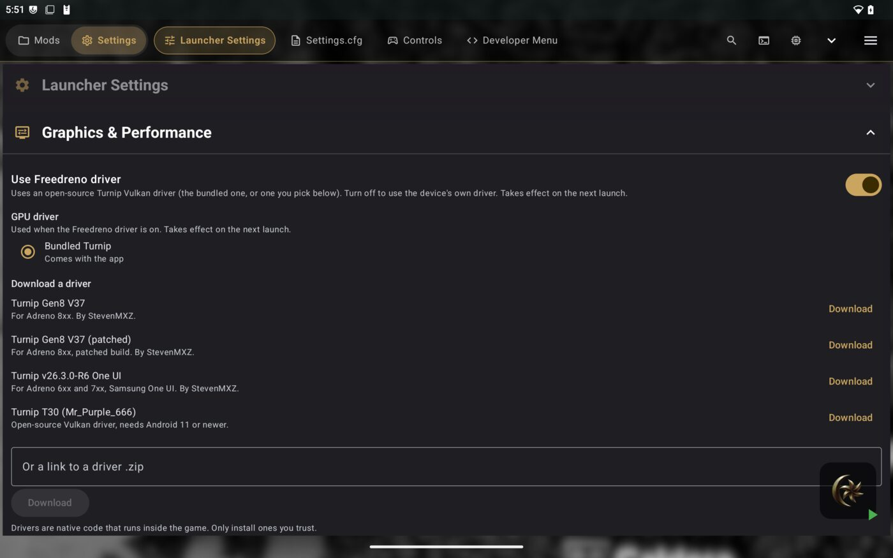

**Settings.cfg** is the game's own settings file, shown as a list of options:

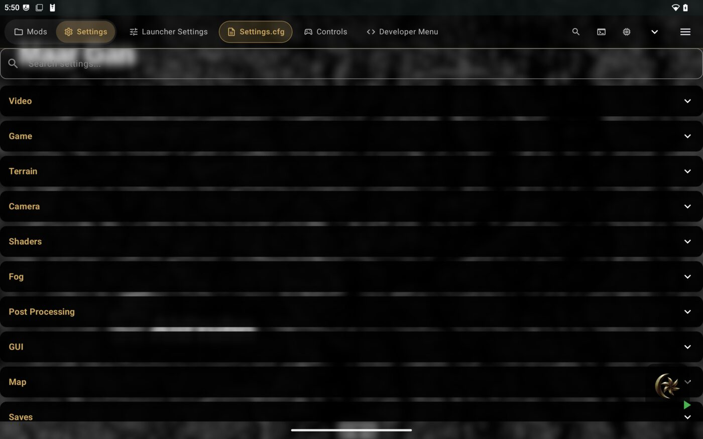

### Add, edit and delete on-screen buttons

Open **Settings > Controls**. **Configure Controls** starts the game in control-editing mode. **Reset Controls** puts the default layout back.

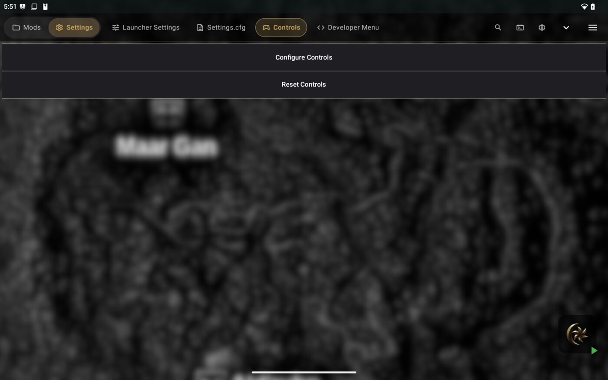

In the game:

1. Tap the **expand arrow** to open the menu, then the **edit icon** to enter edit mode. Tap the icon again to leave it.
2. **Add:** in edit mode, tap the red **+** to add a button. The same + switches on the right thumbstick if it is off.
3. **Move:** press and hold a button, then drag it. It snaps to the grid when you let go.
4. **Edit:** tap the spinning **yellow dots** on a button. The settings box has Options, Interact, Colors and Vibration, plus an icon from a URL, *toggleable*, *show in mouse UI* and *Apply Globally* (use the style on every button).
5. **Resize or delete:** use the **Increase Size / Delete / Decrease Size** row in the same box. **+** makes the button bigger, the bin deletes it, and **-** makes it smaller.
6. Scroll to the bottom and press **Close**, then leave edit mode.

The first time you start, the **Configure Controls Tutorial** walks you through this.

## Help and search inside the app

The **?** icon in the top bar opens the in-app guide. It has the same how-tos as this page, and a search box that finds an answer from a few words (try `nexus`, `load order`, `driver` or `crash`). A search with one or two matches opens the answer straight away.

| | |
|---|---|
| 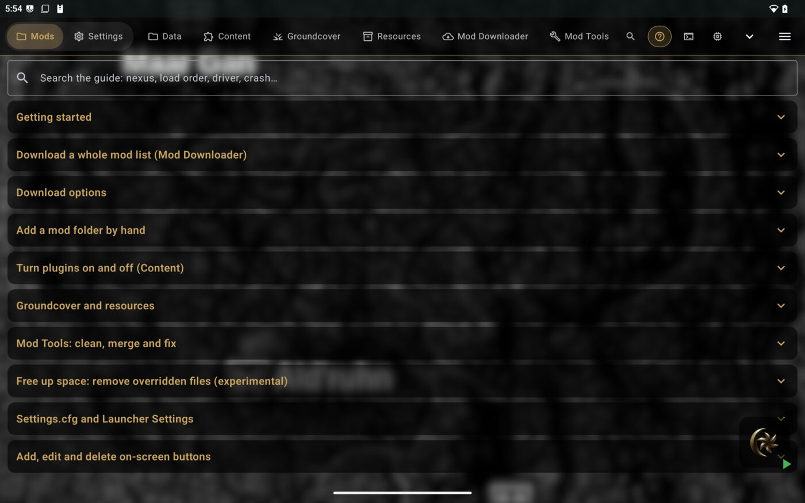 | 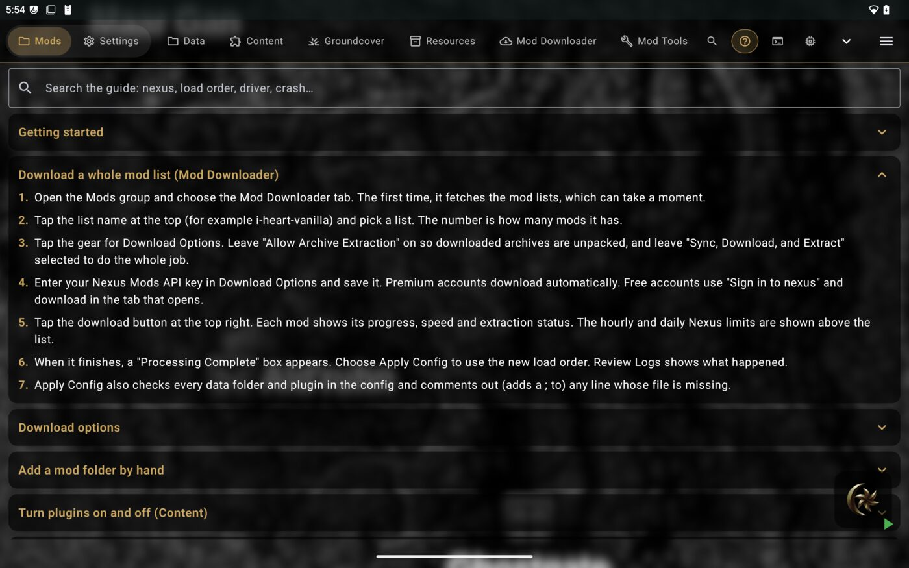 |

## Troubleshooting

- **The game does not start or crashes.** Open the menu (the three lines at the top right) and choose **View last crash**. **Settings > Launcher Settings > System & Debug** has the custom log output.
- **A line in `openmw.cfg` starts with `;`.** Its file was missing when the launcher checked, so it was turned off. Download the mod again and remove the `;`.
- **No Morrowind files found.** Check that the first Data row points at the folder that contains `Morrowind.esm`.
- **Downloads stop.** Check the Nexus limits above the list, the free space shown in the downloader, and your connection.
- **Black screen or graphics glitches.** Try a different GPU driver (see above).

---

# For developers

OpenMW for Android and iOS, built from one repo with **one shared native build** (`cpp/CMakeLists.txt`).

```
androidApp/   Native Android app (Compose + Hilt). Gradle externalNativeBuild -> ../cpp
composeApp/   Kotlin Multiplatform launcher: the iOS "ComposeApp" framework (+ an Android library)
iosApp/       Xcode project. Embeds the ComposeApp framework and the natively built libs
cpp/          Shared C++ build: vcpkg deps, OpenMW, MoltenVK (iOS), Alpha3/kram/dethrace/MegaMod (Android)
```

## One CMakeLists, two platforms

`cpp/CMakeLists.txt` detects the platform (`ALPHA3_PLATFORM` = `android | ios | ios-simulator`) and
branches on `ALPHA3_IS_ANDROID` / `ALPHA3_IS_IOS`. Everything platform specific is chosen there:

| | Android | iOS |
|---|---|---|
| OpenMW source | `OursCodeur/openmw` `clockwork-alpha` | `OursCodeur/openmw` `clockwork-alpha` |
| OpenMW patches | `cpp/openmw/patches/android/` | `cpp/openmw/patches/ios/` |
| Extra vcpkg ports | none (official ports) | `cpp/vcpkg-extras/ports-ios/` (sdl2, luajit) |
| Graphics | glad + GLES / Vulkan | SDK GLES3 + static MoltenVK |
| Output goes to | `androidApp/src/main/{jniLibs,assets}` | `iosApp/{EmbeddedLibsDevice,EmbeddedLibsSim,OpenMWAssets}` |
| Extra targets | `Alpha3`, `kram`, `dethrace`, `uqm` | `device_ipa` |

Shared by both: `cpp/vcpkg-extras/{vcpkg.json,ports,triplets}` (platform-conditional entries).

## Building

Android (Linux/macOS, NDK 29.0.14206865):

    ./gradlew :androidApp:assembleDebug

iOS (macOS + Xcode only):

    ./gradlew :composeApp:buildNativeIos                          # device libs (default)
    ./gradlew :composeApp:buildNativeIos -PnativeIosPlatform=both # + simulator
    open iosApp/iosApp.xcodeproj                                  # then Run

Xcode's build phase calls `./gradlew :composeApp:embedAndSignAppleFrameworkForXcode` from the repo root,
which also triggers the native build for the platform Xcode is targeting.
`-PnativeIos=false` skips the native build. Signed `.ipa`: `cmake --build composeApp/build/cmake-ios --target device_ipa`.

iOS runs stock OpenMW (`cpp/openmw-upstream`, patches `common/` + `ios/`) on Apple's OpenGL ES 3.0, through glad and the
same OSG GLES patches as Android (`cpp/vcpkg-extras/ports/openmw-osg`). Apple's OpenGL ES stops at 3.0, so there are no
compute shaders (clustered lighting and compute ripples are off). `-DALPHA3_IOS_OPENMW_FORK=ON` builds the Vulkan fork
(MoltenVK) instead.

TestFlight: `iosApp/ci/testflight.sh` builds the device libraries, archives and uploads to App Store Connect, signed
automatically through an App Store Connect API key (`ASC_KEY_ID`, `ASC_ISSUER_ID`, `ASC_KEY_P8` or `ASC_KEY_P8_BASE64`).
The GitLab job `iosTestFlight` runs it on tags (and by hand) on a Mac runner tagged `$IOS_RUNNER_TAG` (default `macos`).

## Licensing

See `LICENSE`, `THIRD_PARTY_NOTICES.md`, `RELEASE_COMPLIANCE.md` and `3rdparty-licenses.txt`.
